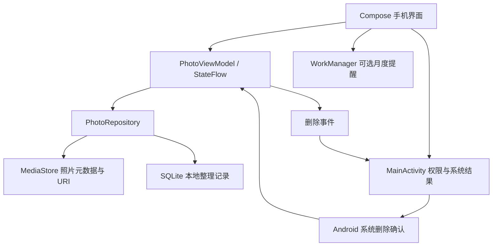

# Android 实现方案

## 产品定位

**Photo Cleaner**：面向英语国家的照片整理工具。核心任务是每次整理一个月，在保留与删除之间快速作出决定；先复核，后交给系统删除。首版只管理照片，不加入重复检测、AI 搜索、视频压缩、云同步或付费墙。2026-10-31 增加清理完成后的 AdMob 插屏，规则见 cleanup-ads/VALIDATION.md。

最低 Android 8.1（API 27），目标 API 36。采用 Kotlin + Jetpack Compose 原生界面，对齐当前 HTML 原型：中性灰白背景、系统蓝操作、系统红删除按钮、本月横图、月份卡片、黑底大图整理和底部导航。设置例外：继续使用原有底部弹窗，仅统一配色。

## 页面与行为

| 页面 | 核心行为 | 状态与保护 |
| --- | --- | --- |
| 首次进入 | 解释用途，用户主动选择照片权限 | 不在启动时直接弹权限，不授权仍能查看隐私说明 |
| Months | 本月横图、其他月份双列、完成标记、重新整理 | 部分授权显示提示；只统计可访问的照片 |
| 月份整理 | 上保留、下移除、按钮操作、撤销、完整显示 / 填满 | 每次记录写入成功再显示下一张；忙碌时不重复操作 |
| To remove | 三列多选、点击多选、保留选中项、确认删除 | 返回恢复原来的筛选位置；确认框显示文件大小，最多一批 2,000 张 |
| 完成 | 月份进度、保留数量、待删除数量；删除后显示数量和文件大小 | 文件大小不是系统磁盘空闲空间承诺 |
| 设置 | 每月提醒、照片访问、评价、隐私、重置进度 | 提醒默认关闭；重置不删除照片，也不恢复已删除照片 |

不提供 Vault 或独立保留相册，照片保留在原来的月份。完成标记表示全部已有整理决定，不阻止再次浏览或修改决定。撤销历史保存在当前 ViewModel 会话中，离开月份重新打开、进程结束或批量保留后清空；已保存的整理决定不会丢失。

## 架构

| 文件 / 层 | 职责 |
| --- | --- |
| `MainActivity.kt` | 权限请求、删除系统界面、生命周期刷新、照片变化监听、打开商店和公开政策 |
| `PhotoViewModel.kt` | 单一 UI 状态、串行本地写入、整理流程、撤销、删除操作状态 |
| `data/ReviewSession.kt` | 本次浏览队列，与持久化整理决定分离；完成月份重进、撤销位置和外部删除后的队列更新 |
| `ui/ReviewScreen.kt` | 透明照片层上下拖动，85% 后卡跟随放大，按钮与手势共用提交动画；固定背景和控件 |
| `data/Models.kt` | 月份分组、记录有效性、待删除候选和 2,000 张上限 |
| `data/PhotoRepository.kt` | 共用的数据入口，调度 IO 和本地记录，不包含系统版本分支 |
| `platform/PhotoPlatform.kt` | 统一权限与平台能力；生成对应系统的确认提示 |
| `platform/MediaStorePhotoSource.kt` | 按版本选择查询字段和媒体 URI，统一映射为 Photo |
| `data/PhotoDeletion.kt` | 共用删除状态机、逐张结果、授权后重试、回调校验、中断恢复 |
| `platform/AndroidDeletionBackend.kt` | 旧版直接删除、Android 10 逐张授权、Android 11+ 系统批量删除三种策略 |
| `platform/DeletionJournal.kt` | SQLite 持久化操作和逐张回执 |
| `platform/TestMediaScope.kt` | 仅隔离 Debug 测试版使用的媒体查询与删除白名单 |
| `data/ReviewDatabase.kt` | SQLite 读写；批量保留和清理使用事务 |
| `ui/` | 页面、主题、弹层、手势和图片展示；Coil 按视图尺寸解码 |
| `reminders/MonthlyReminder.kt` | 用户启用后，每月 1 日当地时间约 20:00 的普通后台通知任务 |

首版使用单模块，避免为了一个功能拆出多个构建模块。业务规则独立成纯 Kotlin 函数，便于测试和以后迁移。

## 数据和状态

- `Photo`：媒体 URI、显示名称、时间、大小、宽高、修改时间。只有元数据常驻内存，照片按需解码。不会读取位置 EXIF、识别人脸或上传照片。
- `ReviewRecord`：URI 主键、照片签名、KEEP/REMOVE/未决定、本地 favorite。签名由修改时间、大小、拍摄时间、宽高组成；签名变化后旧决定失效，降低 URI 重用/照片编辑继承旧删除标记的风险。
- `MonthGroup`：按设备时区和年月组织照片，跨年倒序。进度只计入当前可访问且签名有效的决定。
- SQLite 持久化决定；SavedStateHandle 保存当前月份和页面；SharedPreferences 保存提醒设置；独立 SQLite 删除日志保存操作 ID、阶段、照片签名与逐张结果。
- 不把图片复制到 App 数据库；Coil 磁盘缓存关闭，可有内存缓存。禁用备份与设备迁移，避免整理记录离开设备。

## 权限设计

- Android 8.1–12：`READ_EXTERNAL_STORAGE`，限制到 API 32。
- Android 8.1–9：真正删除前按需申请 `WRITE_EXTERNAL_STORAGE`，仅声明到 API 28；拒绝则不删除。
- Android 13：`READ_MEDIA_IMAGES`。
- Android 14+：同时声明 `READ_MEDIA_IMAGES` 和 `READ_MEDIA_VISUAL_USER_SELECTED`，兼容系统选择部分照片。
- 部分授权只显示当前获准的照片，保留隐藏照片的历史记录；无法访问不能被当成“已删除”。用户可主动再次选择更多照片。
- 每次回前台重新读取权限与照片；内容变化后防抖刷新。拒绝授权显示可重试入口及 Android 设置入口。
- 提醒开启时才请求 `POST_NOTIFICATIONS`。普通 WorkManager 任务会随系统电量管理延迟，不申请精确闹钟。
- 不申请视频、位置、所有文件管理、互联网、通知监听或辅助功能权限。旧版存储写权限仅用于 Android 8.1–9 的照片删除。

## 删除流程

1. 用户滑动只修改本地 REMOVE 决定，不动原照片。
2. 待删除页允许取消选择、放大、改为保留。
3. 应用显示数量、预计移除的文件大小、永久删除提示。
4. 过滤当前可访问、签名匹配、明确选择且仍为 REMOVE 的照片；去重并限制每批 2,000 张。
5. 在 IO 线程把请求及每张照片的签名写入删除日志，重新核对照片是否仍是所选对象。
6. Android 8.1–9：申请存储写权限后逐张调用媒体删除；App 的“Delete permanently”是最后一次删除确认。Android 10：遇到可恢复权限异常时请求该照片授权，批准后重试实际删除。Android 11+：调用系统批量删除请求。
7. 权限批准不直接计为删除成功；旧版以真实删除返回值为准，新版以系统批量完成结果为准。成功、失败、取消分别记录，只清理成功照片对应的整理记录。
8. Android 10 中途取消会停止剩余队列，保留此前已成功删除的统计；不会宣称取消可以恢复此前删除的照片。
9. 进程中断后不推测缺失照片一定已删除，也不自动重试未完成操作。日志中的明确成功可幂等清理，执行中但未记录结果的照片视为结果未确认，提示重新复核。
10. 系统回调匹配持久化操作 ID 和等待阶段，旧回调不能确认新的删除请求。发布过程不依赖测试专用的白名单或测试参数。

系统永久删除没有 App 撤销能力；云同步、厂商相册与备份行为由对应服务决定，不能承诺云端同步删除或可恢复。

## 上架与后续迭代

照片处理无服务端或账号。已接入 AdMob / UMP，隐私说明和发布检查表同步更新；正式上线须根据最终广告配置填写 Data safety。

交付后需完成真机覆盖：API 27/28/29/30/32/33/34/35/36、部分授权增减、拒绝/永久拒绝、通知关闭、外部照片编辑和删除、超大照片库、横屏及大字体、TalkBack、进程回收、系统删除错误、系统时间/时区变化后的提醒。

性能边界：当前一次查询全量获准照片元数据，使用惰性网格显示缩略图，适合首版验证。超大库应先量测再增加增量索引、分页、后台差异同步和分组缓存；当前不宣称完成十万张照片性能验证。时间或时区变化时 WorkManager 执行时间可能漂移，提醒是近似提醒。

## 兼容范围与验证方式

单模块中保持一套 UI、月份分组、滑动决定、撤销和数据库逻辑。权限和字段选择集中在平台能力对象；删除平台调用封装在三个后端，共用一个协调器。没有通过降低 targetSdk 或开启 legacy storage 绕过现代存储限制。

纯 Kotlin 测试覆盖三种删除策略的队列规则、部分成功、拒绝权限、授权后真实重试、重复授权防循环、旧回调、逐张回执与中断恢复。设备测试使用独立 applicationId，媒体查询只查明确注册的随机测试文件名，显示和删除再检查精确 URI 白名单。正常 Release 不包含启用的测试模式。

Android 10 外部应用照片的系统授权界面仍需对应版本设备验证；规则模拟测试不等于完成系统界面回归。
